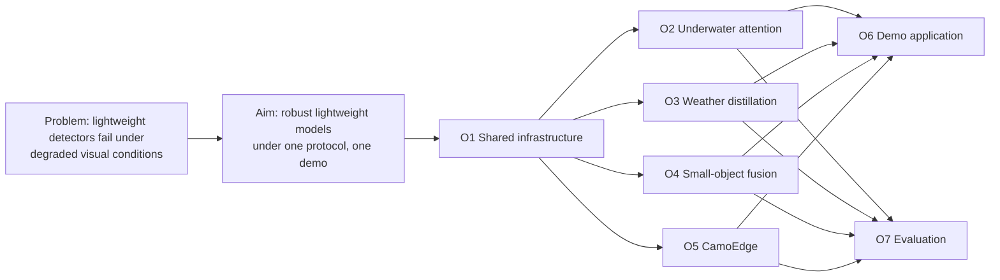
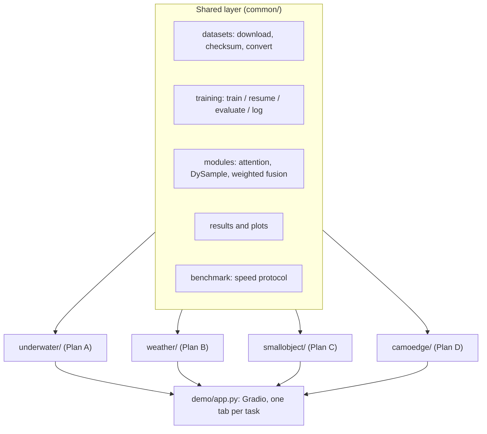
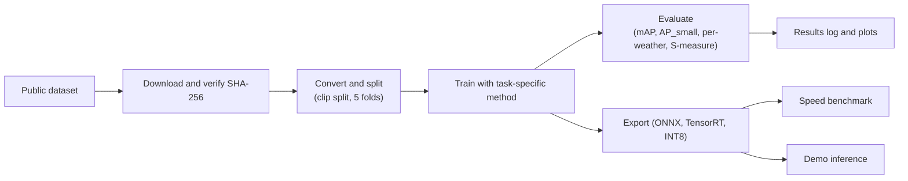

# Robust Lightweight Object Detection under Challenging Visual Conditions: Underwater, Adverse Weather, Small-Scale and Camouflaged Scenes

**Project Proposal (Draft 1)**

| Item | Detail |
|---|---|
| Names | [Member 1], [Member 2], [Member 3], [Member 4] |
| HKMU IDs | [ID 1], [ID 2], [ID 3], [ID 4] |
| Programme of Study | [Programme name and code, Computer Science] |
| Supervisor | [Supervisor name, to confirm] |
| Date | [Submission date] |

> Draft notes, remove before submission: items in square brackets still need team input. Chapters 1 to 3 are about 3,000 words including tables, excluding diagrams. References were checked online on 2026-11-19 against publisher, CVF, PMLR, IJCAI, arXiv or DBLP records; the EfficientDet page range differs between CVF (used here) and IEEE Xplore (10778–10787).

---

## Table of Contents

1. Introduction
   1.1 Introduction
   1.2 Project Aim and Objectives
   1.3 Value Proposition
2. Background and Literature Review
   2.1 Review of Existing or Related Solutions
   2.2 Highlight of the Proposed Solution
3. Preliminary Methodology
   3.1 Overview
   3.2 Requirements, Supporting Technologies and Technical Gap
   3.3 Architecture and High-Level System Design
References
Appendix A. Project Plan
Appendix B. Members' Roles and Responsibilities

---

## Chapter 1. Introduction

### 1.1 Introduction

Object detection, locating and classifying objects in an image, is mature under controlled conditions. Real-time detectors such as the YOLO family (Redmon et al., 2016) now reach high accuracy on benchmarks like MS COCO (Lin et al., 2014) at hundreds of frames per second. Many applications, however, operate where images are far from benchmark quality: an underwater robot surveying a reef, a traffic camera during a storm, a drone flying at altitude, or a wildlife camera watching an animal that blends into its surroundings. In these settings a detector trained on clean images loses much of its accuracy.

This project studies four such conditions:

- **Underwater scenes**, where light scattering and absorption reduce contrast and shift colours towards green and blue.
- **Adverse weather**, where fog, rain, snow and sandstorms hide or distort objects.
- **Small objects**, such as pedestrians and vehicles in aerial images, which occupy only a few pixels and can vanish after the network downsamples the image.
- **Camouflaged objects**, whose colour and texture match the background so closely that their boundaries are hard to find.

Each condition harms a detector in a different way. Underwater and weather degradation lower the signal itself: edges and colours that the network learned from clean images are weaker or replaced by noise such as raindrops and floating particles. Small objects are present in the image but disappear inside the network, because a feature map at stride 32 represents a 16-pixel pedestrian with less than one cell. Camouflage is harder still, because the object is fully visible yet its features look like background, so the network must rely on subtle boundary and shape cues.

All four share one tension. Accuracy must improve, but the model must stay small and fast enough for an embedded or mobile device, typically at least 30 frames per second (FPS). Most published work studies one condition at a time, each with its own datasets, settings and speed measurements, so results are hard to compare and it is unclear which improvements are worth their cost. This project addresses all four conditions with one shared code base, one evaluation protocol and one demonstration application.

### 1.2 Project Aim and Objectives

**Aim.** To design, implement and evaluate a set of lightweight models that remain accurate under four challenging visual conditions (underwater, adverse weather, small scale and camouflage), compared under one reproducible protocol and integrated into a single demonstration application.

*Lightweight* means a model of a few million parameters that runs in real time on a single consumer GPU. *Robust* means that accuracy under the degraded condition improves over an equally sized baseline without losing that speed. *One protocol* means that every baseline and every variant shares the data split, image size, training length and augmentation, and that every reported number is the mean and standard deviation of three random seeds.

**Objectives.**

| # | Objective | Measure of completion |
|---|---|---|
| O1 | **Set up** shared data, training, results-logging and speed-measurement infrastructure for all four tasks. | Every task has a logged baseline result produced by the shared code. |
| O2 | **Design and implement** lightweight attention modules inside YOLO26 for underwater detection (Plan A). | mAP@0.5 above the same-size baseline (3 seeds) while keeping ≥ 30 FPS. |
| O3 | **Design and implement** knowledge distillation from a YOLO26m teacher to a YOLO26n student for adverse-weather detection (Plan B). | The distilled student beats the plainly trained student with the same parameter count, reported per weather type. |
| O4 | **Design and implement** multi-scale feature fusion, attention and a small-object box loss for aerial images (Plan C). | AP_small above the baseline without a drop in overall mAP. |
| O5 | **Design and implement** CamoEdge, a boundary-guided camouflaged object segmentation network (Plan D). | S-measure, E-measure and weighted F-measure up, mean absolute error down, on COD10K and CAMO. |
| O6 | **Implement** a demonstration application with one tab per task for images, videos and a webcam. | All four tabs run with the final models. |
| O7 | **Evaluate** all models through ablation studies, multi-seed runs, an accuracy–size–speed comparison and a failure-case analysis. | Every number planned for the report exists as mean ± std. |

Figure 1 shows how the objectives fit together: O1 is the foundation, O2 to O5 run in parallel, one per team member, and O6 and O7 bring them together.

*Figure 1. Problem, aim and objectives.*

The four technical objectives were chosen so that each tests a different kind of remedy: O2 changes what the network attends to, O3 changes how the network is trained without changing its size, O4 changes the network's structure and loss to keep fine detail, and O5 adds an explicit boundary signal. Together they cover the main families of lightweight improvement found in the literature, which lets the final evaluation (O7) compare not only models but also strategies.

### 1.3 Value Proposition

**Immediate value.** The project delivers four lightweight models, each targeting one condition, together with ablation evidence for every design decision, so a reader can see what each added module contributes and what it costs in size and speed. It also delivers a reusable evaluation protocol: fixed data splits with checksums, a results log that records the code version and GPU of every run, and one speed benchmark.

**Ripple effect.** The findings are relevant to underwater robotics, traffic monitoring, drone inspection and wildlife monitoring, where small devices must run detectors in poor conditions. Because the pipeline is shared and documented, later students can replace a model and compare against the same baselines. Negative results, such as a module that brings no gain on top of a modern detector, will also be reported, since they save others from repeating the experiment.

---

## Chapter 2. Background and Literature Review

### 2.1 Review of Existing or Related Solutions

#### 2.1.1 Real-time detectors

One-stage detectors predict boxes and classes in a single pass. YOLO (Redmon et al., 2016) started the family; feature pyramids (Lin et al., 2017) and weighted bidirectional fusion (Tan et al., 2020) later improved multi-scale detection. YOLOv10 (Wang et al., 2024) removed non-maximum suppression (NMS) at inference through a one-to-one head, cutting post-processing latency. YOLO26, the newest Ultralytics release and our base model, keeps this NMS-free design, removes distribution focal loss so that boxes are four direct distances, and adds a small-target-aware label assignment. *Lesson:* a modern baseline already includes several tricks that older papers added, so improvements must be measured against it, not against an older model.

#### 2.1.2 Underwater detection

Two approaches exist. The first enhances the image before detection, for example with grey-world white balance or contrast-limited adaptive histogram equalisation (Zuiderveld, 1994). The second places attention modules inside the network so it learns which channels and positions matter: CBAM (Woo et al., 2018), Coordinate Attention (Hou et al., 2021), ECA (Wang et al., 2020) and the parameter-free SimAM (Yang et al., 2021). Benchmarks include Brackish (Pedersen et al., 2019) and DUO (Liu et al., 2021). *Lessons:* an enhancement step adds latency, and frames from the same video can leak across a random split and inflate accuracy, so splits must be made by video clip.

#### 2.1.3 Adverse weather

Restoration networks remove fog or rain before detection, at extra cost. Knowledge distillation (Hinton et al., 2015) instead trains a small student to imitate a larger teacher, through soft class outputs or intermediate features (Romero et al., 2015), so the student gains accuracy with no inference cost. DAWN (Kenk & Hassaballah, 2020) offers about 1,000 real images in fog, rain, snow and sand. *Lessons:* such a small dataset overfits easily and gives noisy results, so cross-validation and several seeds are required; distillation only helps when the teacher is clearly better than the student.

#### 2.1.4 Small objects

Small-object detectors add a high-resolution P2 output level, better upsampling such as DySample (Liu et al., 2023), weighted feature fusion (Tan et al., 2020) and attention. The Normalised Wasserstein Distance (Wang et al., 2021) replaces IoU-based box measures, which change sharply for tiny boxes. Sliced inference (Akyon et al., 2022) tiles the image without retraining. VisDrone (Zhu et al., 2021) is the standard aerial benchmark. *Lesson:* each addition raises compute, and YOLO26's own small-target assignment may already capture part of the gain.

#### 2.1.5 Camouflaged objects

Camouflaged object detection is usually posed as segmentation. SINet and SINet-V2 (Fan et al., 2020; Fan et al., 2022) imitate a search-then-identify process, and boundary-guided networks such as BGNet (Sun et al., 2022) predict edges to sharpen masks. Transformer encoders such as PVTv2 (Wang et al., 2022) give strong global context. COD10K and CAMO (Le et al., 2019) are the main benchmarks, scored with S-measure (Fan et al., 2017), E-measure (Fan et al., 2018), weighted F-measure and mean absolute error. *Lesson:* region-level metrics can hide boundary improvements, so a boundary metric should be reported as well.

#### 2.1.6 Domain requirements

| Requirement | Why it matters |
|---|---|
| R1 Lightweight (a few million parameters) | Edge and mobile deployment |
| R2 Real time (≥ 30 FPS end to end) | Video and robotics |
| R3 Robust to the specific degradation | The purpose of each subtask |
| R4 Fair comparison | Gains must come from the method, not from settings |
| R5 Reproducible | Results must be checkable and repeatable |

Most methods reviewed meet R3 for their own condition but rarely report R1, R2, R4 and R5 together.

### 2.2 Highlight of the Proposed Solution

| Aspect | Typical existing work | This project |
|---|---|---|
| Scope | One condition | Four conditions, one shared code base |
| Base model | Older YOLO versions | YOLO26 (detection) and PVTv2 (segmentation) |
| Comparison | Different settings per paper | Same split, size, epochs and augmentation; 3 seeds |
| Speed | Often frames per second without a protocol | One benchmark: batch 1, FP16, 640 px, end-to-end latency |
| Data hygiene | Random splits | Clip-level split for Brackish; 5-fold cross-validation for DAWN |

Our contribution is a careful, fair comparison of lightweight additions on top of a current detector, not a new state of the art. We expect to improve on our own baselines; we do not expect to beat the best published models, which are larger and trained with more compute. Two limits apply: the project has no embedded board such as a Jetson, so edge suitability rests on parameter count, GFLOPs and measured GPU and CPU latency; and because YOLO26 already contains several small-object and attention components, gains may be modest. Plan D also differs from the others: it is a segmentation network, not a YOLO detector, but it follows the same protocol and appears in the same demo.

---

## Chapter 3. Preliminary Methodology

### 3.1 Overview

The project follows a divide-and-conquer approach: a shared foundation (O1) supports four subsystems developed in parallel, one per member (O2 to O5), which are merged into one demo (O6) and one evaluation (O7). Work moves through seven phases, from data and baselines through quick configuration changes, new modules, custom losses, final multi-seed runs and compression, to integration. Each phase ends with a team review gate before the next begins (Appendix A). Every change is tested one at a time against an identical baseline, so each result can be traced to a single cause.

Experiments follow the same steps in every plan. Exploration uses one seed to keep compute low; only the variants that survive exploration are rerun with three seeds, and only those numbers are reported. A difference smaller than about one mAP point on a small test set is treated as noise. Every run appends a row to a shared results log that records the model, variant, seed, metrics, git commit, library version and GPU, so any number in the report can be traced to the code that produced it. The model family is fixed to YOLO26 for the detection plans; a fallback to YOLO11 or YOLOv8 is allowed only for a reproduced technical blocker approved by two other members and recorded in the decisions log. Results are never tuned by changing the dataset or protocol, and negative results are kept.

Training runs on members' local GPUs and on free Google Colab. Because Colab sessions end without warning, every run saves a checkpoint each epoch and can resume.

The foundation and the first baselines are already in place. Each plan has been trained for 50 epochs on its real dataset on a local RTX 5060 Ti GPU (one seed, validation or held-out data):

| Plan | Dataset | Baseline model | Result |
|---|---|---|---|
| A | Brackish | YOLO26n | mAP@0.5 0.597 |
| B | DAWN, fold 0 | YOLO26m teacher / YOLO26n student | mAP@0.5 0.647 / 0.635 |
| C | VisDrone | YOLO26n | mAP@0.5 0.291, AP_small 0.083 |
| D | COD10K / CAMO | PVTv2-B2 encoder-decoder | S-measure 0.853 / 0.854 |

These baselines already point to problems the methodology must address. In Plan A the crab class is never detected, although it has the most training boxes, so the labels and images of that class will be inspected before any variant is compared; the validation score also peaks within the first ten epochs, a sign of overfitting. In Plan B the teacher is only 1.2 points better than the student overall and is worse in sandstorm images, which leaves little room for distillation; a stronger or longer-trained teacher will be tried first. In Plan C small objects score far below the overall mean, confirming that the task is worth targeting. These numbers come from one seed and are not final results.

### 3.2 Requirements, Supporting Technologies and Technical Gap

| Element | Description |
|---|---|
| Users and use cases | **Researchers** train, resume and compare models. **Application developers** take a final model and deploy it. **Demo visitors** upload an image or video, or use a webcam, and view detections. |
| Functional requirements | Download datasets and verify their SHA-256 checksums; convert and split them; train, resume and evaluate each model; append one row per run to a results log; measure speed; run inference for each task; serve a demo with one tab per task. |
| Non-functional requirements | ≥ 30 FPS end to end (batch 1, FP16, 640 px); parameters and GFLOPs reported; reproducible (pinned Ultralytics 8.4.175, git commit and GPU recorded in every row); resumable runs; datasets never redistributed. |
| Key technologies | PyTorch; Ultralytics YOLO26; timm (PVTv2 encoder); pycocotools (COCO metrics); PySODMetrics (camouflage metrics); ONNX Runtime and TensorRT (export, INT8); Gradio (demo); local NVIDIA GPUs and Google Colab (training). |
| Technical gap | (1) Custom layers inserted into a YOLO26 configuration are not width-scaled and can break pretrained weight loading; we infer channels lazily and map pretrained weights explicitly. (2) YOLO26 has no distribution focal loss, so distillation of box outputs must be redesigned at box level. (3) NMS-free inference is capped at 300 detections, which dense aerial scenes may exceed. (4) Validation uses NMS by default, so we evaluate on the NMS-free head to match what we time. |

### 3.3 Architecture and High-Level System Design

Figure 2 shows the components. A shared layer serves four task modules, which feed the demo.

*Figure 2. Component diagram.*

The shared layer holds everything that must behave identically across plans: dataset preparation, the training loop for the three detection plans, custom layers, results logging, plotting and the speed benchmark. Each task module holds only what is specific to its method, such as the distillation trainer of Plan B or the edge branch of Plan D. Each module also provides a demo tab, so the demo application only mounts tabs and contains no task logic. This separation lets four people work in parallel without editing the same files, and it ensures that a gain in one plan cannot come from a different evaluation routine.

Figure 3 shows how data moves through the system.

*Figure 3. Data-flow diagram.*

Data enters only through the download step, which checks each archive against a recorded checksum, so every member trains on identical files. Datasets themselves are never stored in the repository, because their licences forbid redistribution; only split lists and scripts are shared. After training, evaluation writes both a results row and plots, while export produces the optimised model that the speed benchmark and the demo use, so the speed reported is the speed of the model actually demonstrated.

| Component | Purpose | Input → output | Technique |
|---|---|---|---|
| Dataset tools | Reproducible data | Source archive → checked, split dataset | SHA-256 manifest, clip-level split, stratified folds |
| Plan A model | Underwater detection | Image → boxes | YOLO26n with attention (CBAM, CA, ECA, SimAM) at chosen layers; enhancement and synthetic-turbidity comparisons |
| Plan B trainer | Weather detection | Image + teacher outputs → student | Feature, class (KL) and box-level distillation; optional pruning and static INT8 |
| Plan C model | Small objects | Image → boxes | P2 head, DySample, weighted fusion, attention, NWD loss; sliced inference as reference |
| Plan D model | Camouflage | Image → mask | PVTv2 encoder, Edge Guidance Branch, Edge-Attention Gating (`f' = f ⊙ (1 + gate)`), decoder; structure loss plus edge loss |
| Results log | Fair comparison | Run → one row | Model, variant, seed, metrics, commit, GPU |
| Benchmark | Speed | Model → latency | Batch 1, FP16, 640 px, 50 warm-up and 300 timed iterations |
| Demo | Presentation | Image, video or webcam → annotated output | Gradio, baseline and proposed models side by side |

---

## References

Akyon, F. C., Altinuc, S. O., & Temizel, A. (2022). Slicing aided hyper inference and fine-tuning for small object detection. In *Proceedings of the IEEE International Conference on Image Processing (ICIP)* (pp. 966–970).

Fan, D.-P., Cheng, M.-M., Liu, Y., Li, T., & Borji, A. (2017). Structure-measure: A new way to evaluate foreground maps. In *Proceedings of the IEEE International Conference on Computer Vision (ICCV)* (pp. 4548–4557).

Fan, D.-P., Gong, C., Cao, Y., Ren, B., Cheng, M.-M., & Borji, A. (2018). Enhanced-alignment measure for binary foreground map evaluation. In *Proceedings of the International Joint Conference on Artificial Intelligence (IJCAI)* (pp. 698–704).

Fan, D.-P., Ji, G.-P., Sun, G., Cheng, M.-M., Shen, J., & Shao, L. (2020). Camouflaged object detection. In *Proceedings of the IEEE/CVF Conference on Computer Vision and Pattern Recognition (CVPR)* (pp. 2777–2787).

Fan, D.-P., Ji, G.-P., Cheng, M.-M., & Shao, L. (2022). Concealed object detection. *IEEE Transactions on Pattern Analysis and Machine Intelligence, 44*(10), 6024–6042.

Hinton, G., Vinyals, O., & Dean, J. (2015). *Distilling the knowledge in a neural network* (arXiv:1503.02531). arXiv.

Hou, Q., Zhou, D., & Feng, J. (2021). Coordinate attention for efficient mobile network design. In *Proceedings of the IEEE/CVF Conference on Computer Vision and Pattern Recognition (CVPR)* (pp. 13713–13722).

Kenk, M. A., & Hassaballah, M. (2020). *DAWN: Vehicle detection in adverse weather nature dataset* (arXiv:2008.05402). arXiv.

Le, T.-N., Nguyen, T. V., Nie, Z., Tran, M.-T., & Sugimoto, A. (2019). Anabranch network for camouflaged object segmentation. *Computer Vision and Image Understanding, 184*, 45–56.

Lin, T.-Y., Dollár, P., Girshick, R., He, K., Hariharan, B., & Belongie, S. (2017). Feature pyramid networks for object detection. In *Proceedings of the IEEE Conference on Computer Vision and Pattern Recognition (CVPR)* (pp. 2117–2125).

Lin, T.-Y., Maire, M., Belongie, S., Hays, J., Perona, P., Ramanan, D., Dollár, P., & Zitnick, C. L. (2014). Microsoft COCO: Common objects in context. In *Proceedings of the European Conference on Computer Vision (ECCV)* (pp. 740–755).

Liu, C., Li, H., Wang, S., Zhu, M., Wang, D., Fan, X., & Wang, Z. (2021). A dataset and benchmark of underwater object detection for robot picking. In *Proceedings of the IEEE International Conference on Multimedia & Expo Workshops (ICMEW)*.

Liu, W., Lu, H., Fu, H., & Cao, Z. (2023). Learning to upsample by learning to sample. In *Proceedings of the IEEE/CVF International Conference on Computer Vision (ICCV)* (pp. 6027–6037).

Pedersen, M., Haurum, J. B., Gade, R., Moeslund, T. B., & Madsen, N. (2019). Detection of marine animals in a new underwater dataset with varying visibility. In *Proceedings of the IEEE/CVF Conference on Computer Vision and Pattern Recognition Workshops (CVPRW)* (pp. 18–26).

Redmon, J., Divvala, S., Girshick, R., & Farhadi, A. (2016). You only look once: Unified, real-time object detection. In *Proceedings of the IEEE Conference on Computer Vision and Pattern Recognition (CVPR)* (pp. 779–788).

Romero, A., Ballas, N., Kahou, S. E., Chassang, A., Gatta, C., & Bengio, Y. (2015). FitNets: Hints for thin deep nets. In *International Conference on Learning Representations (ICLR)*.

Sun, Y., Wang, S., Chen, C., & Xiang, T.-Z. (2022). Boundary-guided camouflaged object detection. In *Proceedings of the International Joint Conference on Artificial Intelligence (IJCAI)* (pp. 1335–1341).

Tan, M., Pang, R., & Le, Q. V. (2020). EfficientDet: Scalable and efficient object detection. In *Proceedings of the IEEE/CVF Conference on Computer Vision and Pattern Recognition (CVPR)* (pp. 10781–10790).

Wang, A., Chen, H., Liu, L., Chen, K., Lin, Z., Han, J., & Ding, G. (2024). YOLOv10: Real-time end-to-end object detection. In *Advances in Neural Information Processing Systems (NeurIPS)*.

Wang, J., Xu, C., Yang, W., & Yu, L. (2021). *A normalized Gaussian Wasserstein distance for tiny object detection* (arXiv:2110.13389). arXiv.

Wang, Q., Wu, B., Zhu, P., Li, P., Zuo, W., & Hu, Q. (2020). ECA-Net: Efficient channel attention for deep convolutional neural networks. In *Proceedings of the IEEE/CVF Conference on Computer Vision and Pattern Recognition (CVPR)* (pp. 11534–11542).

Wang, W., Xie, E., Li, X., Fan, D.-P., Song, K., Liang, D., Lu, T., Luo, P., & Shao, L. (2022). PVT v2: Improved baselines with pyramid vision transformer. *Computational Visual Media, 8*(3), 415–424.

Woo, S., Park, J., Lee, J.-Y., & Kweon, I. S. (2018). CBAM: Convolutional block attention module. In *Proceedings of the European Conference on Computer Vision (ECCV)* (pp. 3–19).

Yang, L., Zhang, R.-Y., Li, L., & Xie, X. (2021). SimAM: A simple, parameter-free attention module for convolutional neural networks. In *Proceedings of the International Conference on Machine Learning (ICML)* (pp. 11863–11874).

Zhu, P., Wen, L., Du, D., Bian, X., Fan, H., Hu, Q., & Ling, H. (2021). Detection and tracking meet drones challenge. *IEEE Transactions on Pattern Analysis and Machine Intelligence, 44*(11), 7380–7399.

Zuiderveld, K. (1994). Contrast limited adaptive histogram equalization. In P. S. Heckbert (Ed.), *Graphics Gems IV* (pp. 474–485). Academic Press.

*Technical documentation (not academic sources):* Ultralytics YOLO26 documentation, https://docs.ultralytics.com/.

---

## Appendix A. Project Plan

Dates will be set once the FYP schedule is confirmed. Each phase ends with a team review gate (G0 to G6).

| Phase | Main tasks | Deliverable | Status | Dates |
|---|---|---|---|---|
| 0 Foundations | Shared data, results and benchmark code; YOLO26 feasibility checks | Shared code; spike results | Done | [ ] |
| 1 Data and baselines | Prepare four datasets; train baselines; compute budget | Baseline row per task | Done (one seed) | [ ] |
| 2 Quick wins | CBAM and enhancement (A); teacher and distillation checks (B); P2 head (C); structure loss (D) | First comparisons | [ ] | [ ] |
| 3 New modules | Attention placement (A); feature distillation (B); attention, DySample, fusion (C); edge branch (D) | Ablation rows | [ ] | [ ] |
| 4 Custom objectives | Turbidity tests, second dataset (A); head distillation (B); NWD loss (C); edge loss and gating (D) | Proposed method per plan | [ ] | [ ] |
| 5 Final runs | Three seeds (and five folds for B); ablations | Mean ± std tables | [ ] | [ ] |
| 6 Compression and speed | Pruning and INT8 (B); export and speed (all) | Accuracy–size–speed table | [ ] | [ ] |
| 7 Integration | Demo tabs, failure cases, report, presentation | Demo, report | [ ] | [ ] |

## Appendix B. Members' Roles and Responsibilities

All members act as analyst and designer, programmer and tester for their own plan. Additional team roles:

| Member | Plan | Additional role | Shared files stewarded |
|---|---|---|---|
| [Member] | A Underwater | [e.g. Team Coordinator] | `common/datasets.py`, `demo/app.py` |
| [Member] | B Weather | [e.g. Experiment Designer and Data Analyst] | `common/results.py` |
| Ku Sui Ki | C Small objects | [e.g. System Analyst and Designer] | `common/modules.py` |
| [Member] | D CamoEdge | [e.g. Tester and Evaluator] | `common/benchmark.py` |
